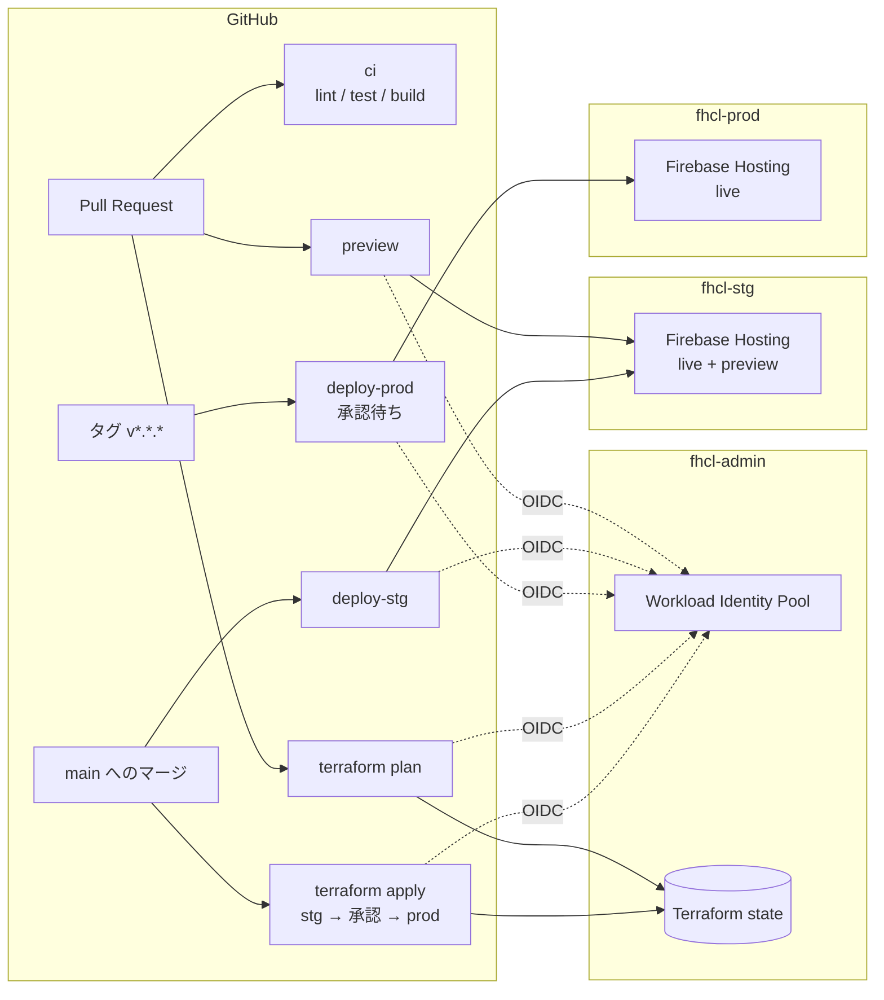

# Firebase Hosting CI/CD Lab

Google Cloud（Firebase Hosting）と GitHub Actions で、1 ファイルの HTML ページを stg / prod の 2 環境へデプロイするパイプラインの検証用リポジトリ。インフラは Terraform で管理し、GCP への認証はすべて Workload Identity 連携（サービスアカウントキーなし）で行う。

| 環境 | URL | デプロイのきっかけ |
| --- | --- | --- |
| preview | `https://fhcl-stg-xxxx--pr-<番号>-<ランダム>.web.app` | PR を作成・更新したとき（7 日で失効） |
| stg | https://fhcl-stg-91cf.web.app | `main` へのマージ |
| prod | https://fhcl-prod-91cf.web.app | `v*.*.*` タグの push ＋ 承認 |

ページには環境・バージョン・コミット・デプロイ日時が表示されるので、どの環境にどの版が出ているかをブラウザで確認できる。

## 全体像



## 使い方

### ページを変更する

1. ブランチを切って `src/index.html` を変更し、PR を作る
2. `ci`（lint / テスト / ビルド）が走り、プレビュー URL が PR にコメントされる
3. マージすると stg に自動でデプロイされる

### prod にリリースする

```sh
git fetch origin
git tag v1.2.0 origin/main   # main にマージ済みのコミットにだけ付けられる
git push origin v1.2.0
```

`deploy-prod` が lint・テストの後に **承認待ち** で止まる。Actions の実行画面の **Review deployments** から承認すると prod にデプロイされる。

### ロールバックする

Actions → **deploy-prod** → **Run workflow**（ブランチは `main`）で、`tag` に戻したいタグ（例: `v1.1.0`）を入れて実行し、承認する。そのタグの時点のコードがビルドされて prod にデプロイされる。

## ローカルでの開発

```sh
npm ci
npm run lint     # HTMLHint / Stylelint / ESLint（HTML 内の CSS/JS も検査）
npm test         # Vitest + jsdom
npm run build    # dist/index.html を生成（環境名などは APP_ENV などで指定。省略時は local）
```

`dist/index.html` をブラウザで開くと、`LOCAL` バッジ付きで表示される。

## ディレクトリ構成

```
src/index.html              配信するページ（CSS/JS を内包）
scripts/                    build.sh / smoke-test.sh / show-oidc-claims.sh
tests/                      単体テスト
infra/bootstrap/            プロジェクト・state バケット・WIF・Terraform 用 SA（ローカルでのみ apply）
infra/modules/hosting-env/  Firebase・Hosting サイト・デプロイ用 SA
infra/envs/{stg,prod}/      環境ごとの Terraform（GitHub Actions で apply）
.github/workflows/          ci / preview / deploy-stg / deploy-prod / terraform
.github/actions/deploy/     ビルド → 認証 → デプロイ → スモークテストの共通処理
docs/                       仕様書・セットアップ手順・動作確認の記録
```

## ドキュメント

| ファイル | 内容 |
| --- | --- |
| [docs/spec.md](docs/spec.md) | 仕様書（決定事項とその理由） |
| [docs/setup.md](docs/setup.md) | 初期セットアップと後片付けの手順 |
| [docs/verification.md](docs/verification.md) | 動作確認の結果と、やってみて分かったこと |
| [TODO.md](TODO.md) | 実行計画と進捗 |
| [CLAUDE.md](CLAUDE.md) | Claude Code 向けの作業ルール |
