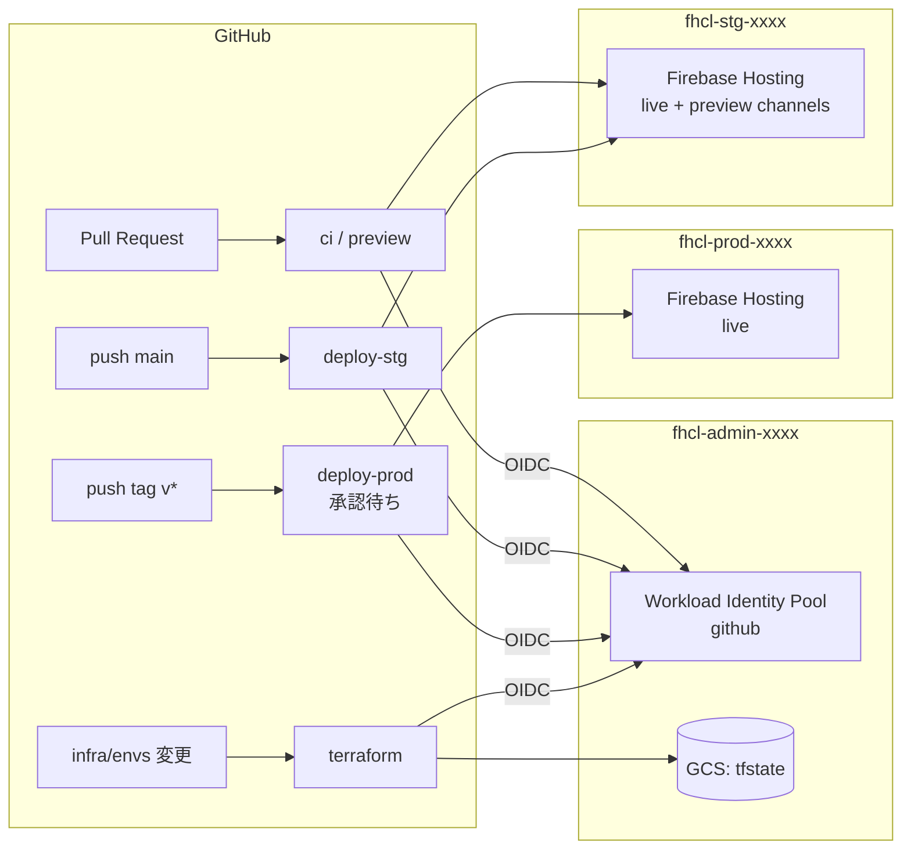

# Firebase Hosting CI/CD ラボ 仕様書

- ステータス: v1.0（2026-10-12、実装と動作確認を完了）
- リポジトリ: `tsatolol/firebase_hosting_cicd_lab`（public）

## 1. 目的

Google Cloud（Firebase Hosting）と GitHub Actions を使い、単一の HTML コンテンツを stg / prod の 2 環境へデプロイするパイプラインを構築し、その動作を確認する。インフラも Terraform でコード化し、GitHub Actions から plan / apply する。

### スコープ外

- カスタムドメイン（`*.web.app` のデフォルトドメインを使う）
- 課金予算アラート
- バックエンド（Cloud Functions / Cloud Run など）

## 2. 決定事項サマリ

| 項目 | 決定内容 |
| --- | --- |
| ホスティング | Firebase Hosting |
| 環境分離 | GCP プロジェクトを分ける（admin / stg / prod） |
| stg デプロイ | `main` ブランチへの push |
| prod デプロイ | `v*.*.*` タグの push、GitHub Environments の承認後に実行 |
| PR 時 | lint・テストに加え、stg プロジェクトのプレビューチャネルへデプロイし、URL を PR にコメント |
| 認証 | Workload Identity 連携（OIDC、サービスアカウントキーは使わない） |
| チェック | HTML/CSS/JS の lint、JS の単体テスト、デプロイ後のスモークテスト |
| コンテンツ構成 | `index.html` 1 ファイルに CSS/JS を内包する |
| ページ内容 | デプロイ情報ページ（環境・バージョン・コミット・デプロイ日時） |
| ロールバック | `workflow_dispatch` で旧タグを指定して prod に再デプロイ |
| インフラ | Terraform（プロジェクト作成も含む）。state は GCS に保存 |
| Terraform の実行 | bootstrap はローカル実行、envs は GitHub Actions で実行 |
| GCP 組織 | なし（個人 Gmail アカウント） |
| プロジェクト ID | `fhcl-<env>-<乱数4桁>`（例: `fhcl-stg-a1b2`） |
| リージョン | `asia-northeast1` |
| 課金アカウント | 変数で渡す（コードに書かない） |
| プレビューの有効期限 | 7 日（PR を更新するたびに延長される） |
| 失敗時の通知 | GitHub の標準通知のみ |
| GitHub Release | 自動作成しない（デプロイ履歴は GitHub Environments で確認する） |
| Terraform 用 SA の権限 | `roles/owner` のまま（§7.2 の理由を参照） |

## 3. 全体アーキテクチャ



### GCP プロジェクト

| プロジェクト | 役割 | 作成方法 |
| --- | --- | --- |
| `fhcl-admin-xxxx` | Terraform state バケット、Workload Identity Pool、Terraform 用サービスアカウント | bootstrap |
| `fhcl-stg-xxxx` | stg 環境の Firebase Hosting（プレビューチャネルもここ） | bootstrap（作成）＋ envs/stg（中身） |
| `fhcl-prod-xxxx` | prod 環境の Firebase Hosting | bootstrap（作成）＋ envs/prod（中身） |

- 3 つのプロジェクトで同じ乱数サフィックスを使う（`random_id` で 1 度だけ生成）。
- Hosting サイト ID はプロジェクト ID と同じにする（デフォルトサイト）。URL は `https://fhcl-<env>-xxxx.web.app`。
- 3 つとも課金アカウントにリンクする（Blaze プラン）。Hosting の利用量は小さく、ほぼ無料枠に収まる想定。

## 4. コンテンツ仕様（`src/index.html`）

### 4.1 表示内容

| 項目 | 内容 |
| --- | --- |
| 環境バッジ | `prod` / `stg` / `preview` / `local` を表示し、環境ごとに色を変える（prod=緑、stg=橙、preview=紫、local=青）。未設定や未知の値は `UNKNOWN`（灰色） |
| バージョン | prod: タグ名（`v1.2.3`）、stg: `main-<短縮SHA>`、preview: `pr-<番号>-<短縮SHA>` |
| コミット SHA | 短縮表示し、GitHub のコミットページへリンクする |
| デプロイ日時 | ISO 8601（UTC）で埋め込み、JS で閲覧者のローカル時刻と「◯分前」に整形して表示する |
| ボタン | 「デプロイ情報をコピー」ボタンで、デプロイ情報を JSON としてクリップボードにコピーする |

### 4.2 デプロイ情報の埋め込み

- `src/index.html` にプレースホルダーを置き、ビルド時に置換して `dist/index.html` を生成する。
  - `__APP_ENV__`, `__APP_VERSION__`, `__COMMIT_SHA__`, `__DEPLOYED_AT__`
- 埋め込み先は `<body>` の `data-*` 属性とする（スモークテストで検証しやすくするため）。

  ```html
  <body data-env="__APP_ENV__" data-version="__APP_VERSION__"
        data-commit="__COMMIT_SHA__" data-deployed-at="__DEPLOYED_AT__">
  ```

- ビルドは `scripts/build.sh` で行う（`src/` を `dist/` にコピーして `sed` で置換するだけ）。プレースホルダーが残った場合はエラーにする。
  - 値は環境変数 `APP_ENV` / `APP_VERSION` / `COMMIT_SHA` / `DEPLOYED_AT` で渡す。省略時はローカル用の値（`local` / `dev` / `git rev-parse HEAD` / 現在時刻）になる。
  - HTML への埋め込みを安全にするため、各値は形式を検証し、想定外の文字を含む場合はビルドを失敗させる。
- 置換前の `src/index.html` をそのまま開いた場合は、各項目を「未設定」と表示する。
- ソースは全環境で同一で、ビルド時に注入する値だけが異なる。

### 4.3 JS の構成（テスト容易性）

- インライン `<script>` 内のロジックは純粋関数として書き、`window.App` に公開する。
  - 例: `formatRelativeTime(isoString, now)`, `envTheme(env)`, `buildDeployInfo(dataset)`
- DOM 操作は `DOMContentLoaded` 時の初期化関数にまとめる。

### 4.4 キャッシュ

- `firebase.json` の `headers` で `index.html` に `Cache-Control: no-cache` を設定し、デプロイ直後に新しい内容が配信されるようにする。

## 5. 品質チェック

| 種類 | ツール | 対象 |
| --- | --- | --- |
| HTML lint | HTMLHint | `src/index.html` |
| CSS lint | Stylelint ＋ `postcss-html` | `index.html` 内の `<style>` |
| JS lint | ESLint（flat config）＋ `eslint-plugin-html` | `index.html` 内の `<script>` |
| 単体テスト | Vitest ＋ jsdom | `index.html` を jsdom で読み込み、`window.App` の関数と初期化後の DOM を検証する。`build.sh` と `smoke-test.sh` も Vitest から実行して検証する |
| スモークテスト | `scripts/smoke-test.sh`（curl） | デプロイ後の URL が HTTP 200 を返し、`data-commit` が今回のコミット SHA と一致すること（リトライあり） |

- Node.js は Active LTS（24）を使い、`.nvmrc` で固定する。
- `npm run lint` / `npm test` / `npm run build` をローカルと CI で共通に使う。

## 6. GitHub Actions ワークフロー

### 6.1 一覧

| ファイル | トリガー | 内容 |
| --- | --- | --- |
| `ci.yml` | `pull_request`, `push: main` | lint、単体テスト、ビルド確認 |
| `preview.yml` | `pull_request`（同一リポジトリからの PR で、アプリ関連のパスが変わったとき） | stg プロジェクトのプレビューチャネル `pr-<番号>` へデプロイ（有効期限 7 日）、スモークテスト、PR に URL をコメント（2 回目以降は同じコメントを更新） |
| `deploy-stg.yml` | `push: main`（アプリ関連のパス）、`workflow_dispatch` | lint・テスト → stg の live チャネルへデプロイ → スモークテスト |
| `deploy-prod.yml` | `push: tags v*.*.*`、`workflow_dispatch`（入力: `tag`） | タグの形式と、タグが `main` に含まれることを確認 → lint・テスト → **承認待ち** → prod へデプロイ → スモークテスト |

アプリ関連のパス: `src/**`、`scripts/**`、`firebase.json`、`package.json`、`package-lock.json`、`.nvmrc`、`.github/actions/deploy/**`、各ワークフロー自身。
| `terraform.yml` | `pull_request` / `push: main`（`infra/envs/**` と `infra/modules/**`） | PR: stg・prod の plan を PR にコメント。main: stg を apply → **承認待ち** → prod を apply |

### 6.2 デプロイの方法

- `google-github-actions/auth` で Workload Identity 連携の認証を行い、資格情報ファイル（ADC）を生成する。
- `firebase-tools`（npm の devDependencies にバージョンを固定）で直接デプロイする。
  - live: `firebase deploy --only hosting --project $PROJECT_ID`
  - preview: `firebase hosting:channel:deploy pr-<番号> --expires 7d --project $PROJECT_ID --no-authorized-domains --json`（このページは Firebase Auth を使わないため、Auth の承認済みドメインへの登録はしない）
- ビルド → 認証 → デプロイ → スモークテストは、3 つのワークフローで共通の composite action（`.github/actions/deploy/`）にまとめる。
- デプロイに使う SA:
  - stg / prod: Environment の Variable `DEPLOY_SA`
  - preview: PR のジョブは Environment を使わないため、`deployer@<STG_PROJECT_ID>.iam.gserviceaccount.com` を組み立てて使う（`account_id` は Terraform で `deployer` に固定）
- デプロイジョブには `environment.url` を設定し、Actions の画面と Environment のデプロイ履歴に URL を表示する。
- `FirebaseExtended/action-hosting-deploy` はサービスアカウントキー（JSON）が前提のため使わない。PR へのコメントは `actions/github-script` で行う。
- 外部アクションはコミット SHA で固定する。
- ワークフローの `permissions` は最小限にし、OIDC を使うジョブだけに `id-token: write` を付ける。

### 6.3 prod デプロイとロールバック

- タグ push 時は、`git merge-base --is-ancestor <tag の SHA> origin/main` でタグが main 上のコミットであることを検証する。
- ロールバックは、`main` 上の `deploy-prod.yml` を `workflow_dispatch` で実行し、入力 `tag` に旧タグ（例: `v1.0.0`）を指定する。旧タグのコミットをチェックアウトしてビルド・デプロイする（通常時と同じく承認が必要）。このとき使われる deploy アクションも旧タグ時点のもの。
- 同時実行は `concurrency: deploy-<env>` で直列化し、進行中のジョブはキャンセルしない。

### 6.4 GitHub リポジトリ設定（手動）

| 設定 | 内容 |
| --- | --- |
| Environment `stg` | デプロイ可能なブランチ: `main` |
| Environment `prod` | Required reviewers: `tsatolol`。デプロイ可能な ref: タグ `v*` とブランチ `main`（ロールバック用） |
| Environment `infra-stg` | デプロイ可能なブランチ: `main` |
| Environment `infra-prod` | Required reviewers: `tsatolol`。デプロイ可能なブランチ: `main` |
| Branch ruleset（`main`） | PR 必須、`ci` の成功を必須にする |
| Tag ruleset（`v*`） | 作成・削除できるのは管理者のみ |
| Variables | §7.4 を参照 |

> 個人リポジトリで reviewer が自分 1 人のため、自分のデプロイを自分で承認する運用になる（「Prevent self-review」は無効にする）。

## 7. インフラ（Terraform）

### 7.1 構成

```
infra/
  bootstrap/          # ローカルでのみ apply（あなたのユーザー権限）
  modules/
    hosting-env/      # stg / prod 共通モジュール
  envs/
    stg/              # GitHub Actions で apply
    prod/             # GitHub Actions で apply
```

- バージョン: Terraform `~> 1.16.0`（CI は 1.16.5）、google / google-beta `~> 8.6`、random `~> 3.9`。正確なバージョンは `.terraform.lock.hcl`（全プラットフォームのハッシュ入り）をコミットして固定する。
- CI（`ci.yml`）で `terraform fmt -check` と `terraform validate`（backend なし）を実行する。

### 7.2 bootstrap（ローカル実行）

個人アカウント（組織なし）ではサービスアカウントがプロジェクトを作成できないため、プロジェクトの作成はユーザー権限で行う。

作成するリソース:

1. `random_id`（プロジェクト ID のサフィックス）
2. プロジェクト `fhcl-admin-xxxx` / `fhcl-stg-xxxx` / `fhcl-prod-xxxx` と課金アカウントのリンク（`deletion_policy = "PREVENT"`）
3. API の有効化
   - 全プロジェクト: IAM、IAM Credentials、STS、Cloud Resource Manager、Service Usage（WIF のトークン交換と、envs の Terraform が API 有効化や SA 作成をするため）
   - admin のみ: Cloud Storage
4. state バケット `fhcl-tfstate-xxxx`（`asia-northeast1`、バージョニング有効、均一なバケットレベルのアクセス、公開アクセス防止）
5. Workload Identity Pool `github` とプロバイダ `github-actions`
   - issuer: `https://token.actions.githubusercontent.com`
   - 属性マッピング: `google.subject = assertion.sub`、`attribute.repository`、`attribute.repository_owner_id`
   - 属性条件: `assertion.repository == 'tsatolol/firebase_hosting_cicd_lab' && assertion.repository_owner_id == '30972312'`
6. Terraform 用サービスアカウント（admin プロジェクト内）
   - `tf-plan`: stg / prod に `roles/viewer`、`roles/iam.securityReviewer`、`roles/serviceusage.serviceUsageConsumer`（envs のプロバイダがクォータを env プロジェクトに付け替えるため）。state は `envs/` 以下だけ読み取り可（`roles/storage.objectViewer`、IAM 条件で prefix を限定）
   - `tf-apply-stg`: stg に `roles/owner`。state は `envs/stg/` 以下だけ読み書き可（`roles/storage.objectUser`、IAM 条件）
   - `tf-apply-prod`: prod に `roles/owner`。state は `envs/prod/` 以下だけ読み書き可（同上）
   - 3 つとも state バケットに `roles/storage.legacyBucketReader`（オブジェクト一覧の取得はバケット単位でしか許可できないため、条件なし）
   - owner を使う理由: この SA は IAM も管理するため IAM の変更権限が必須で、それがあれば自分に owner を付け直せる。権限を絞っても安全性はあまり上がらない。代わりに、使えるジョブを Environment（`infra-prod` は承認必須）で限定し、権限の範囲を 1 プロジェクトに限ることでリスクを抑える
7. Workload Identity 連携の紐付け（`roles/iam.workloadIdentityUser`、subject 単位で制限）
   - GitHub の OIDC トークンの `sub` は、オーナーとリポジトリに数値 ID が付いた形式（`repo:tsatolol@30972312/firebase_hosting_cicd_lab@1415534725:<コンテキスト>`）。リポジトリ ID は変数 `github_repository_id` で渡す
   - `tf-plan` ← `<上記>:pull_request`
   - `tf-apply-stg` ← `<上記>:environment:infra-stg`
   - `tf-apply-prod` ← `<上記>:environment:infra-prod`
   - 実際の `sub` は `terraform.yml` の「Show OIDC token claims」ステップ（`scripts/show-oidc-claims.sh`）で確認できる

state の扱い: `backend.tf` は GCS（prefix: `bootstrap`、バケット名は `-backend-config` で渡す）。初回だけ `backend_override.tf`（ローカル backend）を置いて apply し、作成された GCS バケットに `terraform init -migrate-state` で移す。

初回 apply の順序: ユーザーの ADC で API を有効化するにはクォータプロジェクトが必要なため、① `-target` でプロジェクトだけ作成 → ② admin プロジェクトをクォータプロジェクトに設定 → ③ 残りを apply、の順で行う。手順の詳細は `docs/setup.md`。

入力変数（`terraform.tfvars` は `.gitignore` 対象。サンプルとして `terraform.tfvars.example` をコミットする）:

| 変数 | 例 |
| --- | --- |
| `billing_account_id` | `XXXXXX-XXXXXX-XXXXXX` |
| `github_repository` | `tsatolol/firebase_hosting_cicd_lab` |
| `github_repository_owner_id` | `30972312` |
| `region` | `asia-northeast1` |

出力: 各プロジェクト ID、WIF プロバイダのリソース名、各サービスアカウントのメールアドレス、state バケット名、GitHub Variables を登録する `gh` コマンド（`github_variables_commands`）。

### 7.3 envs/stg・envs/prod（GitHub Actions で実行）

モジュール `hosting-env` が作成するリソース:

1. API の有効化（Firebase Management、Firebase Hosting）。IAM などの基本 API は bootstrap で有効化済み
2. `google_firebase_project`（google-beta）。削除しても state から外れるだけで、GCP 上の Firebase は残る（プロバイダの仕様）
3. `google_firebase_hosting_site`（google-beta、サイト ID = プロジェクト ID のデフォルトサイト）。Firebase 追加時に自動作成されていれば、プロバイダがそれを取り込む。prod は `deletion_policy = "PREVENT"`
4. デプロイ用サービスアカウント `deployer`（env プロジェクト内）
   - `roles/firebasehosting.admin`
   - `roles/serviceusage.serviceUsageConsumer`（firebase-tools が API の有効状態を確認し、クォータをこのプロジェクトに付けるため）
5. Workload Identity 連携の紐付け（`deployer` への `roles/iam.workloadIdentityUser`）
   - stg: `...:environment:stg`（live デプロイ）と `...:pull_request`（プレビュー）
   - prod: `...:environment:prod` のみ

プロバイダ: google / google-beta とも `user_project_override = true`、`billing_project = <env プロジェクト>`（Firebase の API はクォータプロジェクトの指定が必要なため）。

入力変数: `project_id` と `workload_identity_provider`。CI では `TF_VAR_*` で GitHub Variables から渡す。

backend: `gcs`（バケット `fhcl-tfstate-xxxx`、prefix `envs/<env>`）。plan は `-lock=false` で実行する（読み取り専用の SA のため）。

ワークフロー（`terraform.yml`）:

- PR（同一リポジトリのみ）: `tf-plan` で stg / prod の plan を並列実行し、環境ごとに 1 つの PR コメントを作成・更新する
- `main` への push（`infra/envs/**`、`infra/modules/**`、`terraform.yml` の変更時）と `workflow_dispatch`: `infra-stg` で stg を apply → `infra-prod` の承認後に prod を apply
- apply 後、ジョブのサマリーに `deployer` SA と Hosting の URL を表示する（`DEPLOY_SA` の登録に使う）

### 7.4 GitHub Variables

| スコープ | 変数 | 値 |
| --- | --- | --- |
| Repository | `GCP_WIF_PROVIDER` | `projects/<番号>/locations/global/workloadIdentityPools/github/providers/github-actions` |
| Repository | `TF_STATE_BUCKET` | `fhcl-tfstate-xxxx` |
| Repository | `TF_PLAN_SA` | `tf-plan@fhcl-admin-xxxx.iam.gserviceaccount.com` |
| Repository | `STG_PROJECT_ID` / `PROD_PROJECT_ID` | plan / プレビュー用 |
| Environment `stg` / `prod` | `GCP_PROJECT_ID`, `DEPLOY_SA` | 各環境の値 |
| Environment `infra-stg` / `infra-prod` | `TF_APPLY_SA`, `GCP_PROJECT_ID` | 各環境の値 |

シークレットは使わない（Workload Identity 連携のため不要）。

## 8. セキュリティ上の考慮

- サービスアカウントキーは作成しない。
- WIF プロバイダの属性条件でリポジトリとオーナー ID を限定し、さらにサービスアカウントごとに OIDC の `sub`（Environment / pull_request）で使えるジョブを限定する。
- fork からの PR は OIDC トークンを取得できないため、プレビューと terraform plan はスキップする（`github.event.pull_request.head.repo.full_name == github.repository` で判定）。
- prod へのアプリのデプロイとインフラの apply は、どちらも GitHub Environments の承認を必須にする。
- 課金アカウント ID や tfvars はコミットしない。

## 9. 想定される注意点

- 個人アカウントでは、課金アカウントにリンクできるプロジェクト数に上限がある（新しい課金アカウントでは少ない場合がある）。3 プロジェクト分の枠が必要。
- Firebase を初めて使うアカウントでは、Firebase コンソールで利用規約への同意が必要になる場合がある。
- bootstrap を実行する前に、`gcloud auth application-default login` と ADC の quota project の設定が必要。
- Workload Identity の権限が反映されるまで数分かかることがある。

動作確認で分かったこと（詳細は `docs/verification.md`）:

- GitHub の OIDC トークンの `sub` は、オーナーとリポジトリに数値 ID が付いた形式（`repo:tsatolol@30972312/firebase_hosting_cicd_lab@1415534725:<コンテキスト>`）。WIF の principal はこの形式で組み立てる（§7.2）。
- state がない環境では、読み取り専用の `tf-plan` で `terraform init` ができない。plan の前に state の有無を確認し、ない場合は空のローカル state に対して plan する（§7.3）。
- デプロイ直後の数秒は、直前のバージョンが返ることがある。スモークテストはリトライ前提にする。
- Claude Code（Web 版）の環境からはタグを push できない。リリースのタグは人が push する。

## 10. 動作確認シナリオ

結果は `docs/verification.md` に記録した（fork からの PR のシナリオは未実施）。

1. bootstrap を apply し、GitHub の Environments と Variables を設定する
2. `infra/envs` の PR → plan のコメントを確認 → マージ → stg apply → 承認 → prod apply
3. ページを変更する PR → lint・テスト・プレビュー URL のコメントを確認
4. マージ → stg に反映され、スモークテストが成功することを確認
5. `v1.0.0` タグを push → 承認 → prod に反映されることを確認
6. 再度変更して `v1.1.0` をリリース → `workflow_dispatch` で `v1.0.0` を指定してロールバック
7. 異常系: lint エラーの PR が失敗すること、main 上にないコミットへのタグで prod デプロイが失敗すること

## 11. ディレクトリ構成

```
.github/workflows/       ci.yml, preview.yml, deploy-stg.yml, deploy-prod.yml, terraform.yml
.github/actions/deploy/  ビルド → 認証 → デプロイ → スモークテストの共通処理（composite action）
docs/                    spec.md, setup.md（セットアップと後片付け）, verification.md（動作確認の記録）
infra/                   bootstrap/, modules/hosting-env/, envs/{stg,prod}/
scripts/                 build.sh, smoke-test.sh, show-oidc-claims.sh
src/                     index.html
tests/                   index.test.js, scripts.test.js
README.md, TODO.md, CLAUDE.md, firebase.json, package.json, eslint.config.js, .stylelintrc.json, .htmlhintrc, .nvmrc
```

## 12. 未決事項

動作確認で見つかった、対応するかどうかを決めていない事項。

- [ ] プレビューを `ci`（lint・テスト）の成功後にだけデプロイするか。現在は `ci` と並行して動くため、lint エラーのあるコミットでもプレビューが公開される（stg の一時 URL なので実害は小さい）。
- [ ] Environment `infra-prod` の Required reviewers の再確認。フェーズ 4 の prod の apply が承認待ちにならずに実行された。ページの prod デプロイ（Environment `prod`）では承認待ちが機能している。
